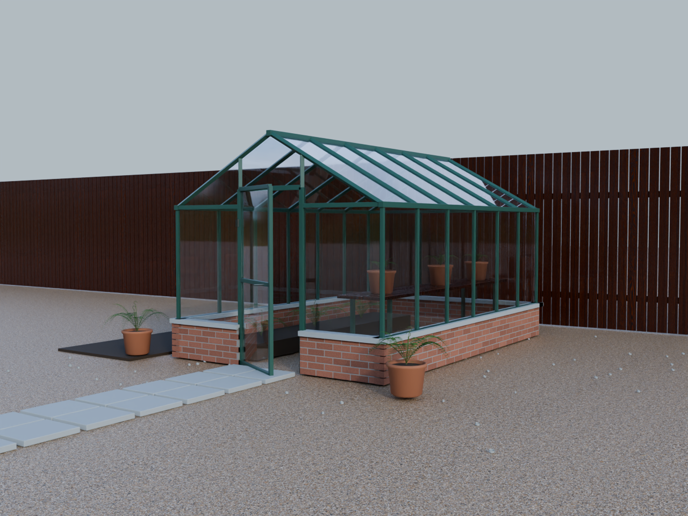
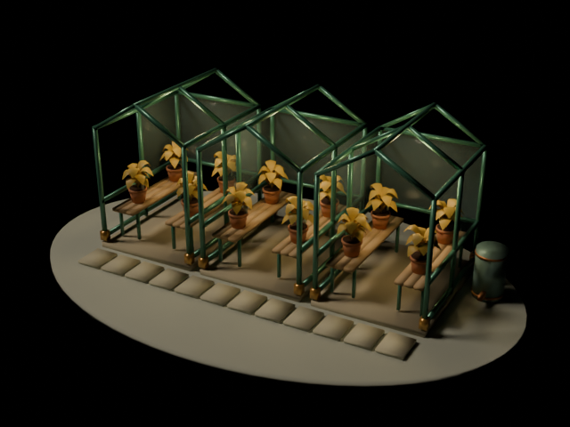

# Scene gallery: evidence and credits

These images are actual Blender Cycles renders of original USD-authored scenes.
They are not generated illustrations or screenshots of an imagined workflow.
Only the two approved scene previews are included here: no raw execution logs,
private engineering assets, credentials, simulation caches or application binaries.

## Garden Light

The 1280 × 960 approved mid-view still uses Blender 4.5.14 LTS and OpenUSD 26.8.
It is the original PNG, with no resizing or content replacement. The render used
32 maximum adaptive samples, separate Open Image Denoise processing, and an AgX
Medium High Contrast display transform with +0.2 exposure. It is a still, not a
completed animation delivery.

- Geometry, greenhouse structure, plant pots and fern-like plants are original
  procedural construction. No downloaded plant model or plant scan was used.
- Typed OpenUSD calls author scene geometry, materials, UVs and standard Preview
  Surface texture connections. Explicit native `pxr` steps cover capabilities
  outside those tools, including composition details and mesh normals.
- Layered USD, flattened USDC, USDZ and relocated files were reopened. Native
  readback preserved 282 expanded meshes and six resolved texture connections.
- Blender handles rendering and final look development. Its full Cycles node
  network is not claimed to be carried by USD or reconstructed identically by
  other renderers.

### Reused assets

The following Poly Haven assets retain their [CC0 license](https://polyhaven.com/license):

- [Evening Meadow](https://polyhaven.com/a/evening_meadow), Alexander Scholten:
  photographic HDR environment.
- [Wood Table 001](https://polyhaven.com/a/wood_table_001), Dimitrios Savva
  (photography), Rico Cilliers (processing): surface texture maps.
- [Gravel Floor](https://polyhaven.com/a/gravel_floor), Matterfield (photography),
  Jenelle van Heerden (processing): surface texture maps.

These scans and photographs are not claimed as original project artwork.
The original texture files are not bundled with this documentation preview.

## Seedlight Conservatory

This 640 × 480 amber-variant still is from the original stylized three-bay
conservatory study. It is a technical assembly example, not a photorealism or
botanical-accuracy benchmark. No external models, textures or HDR images were
used in this scene.

- 27 native instances use four prototypes, relative references, a payload and
  layered layout/lighting/shot opinions across eight source layers.
- Native save/reopen, relocation, flattened export and USDZ readback matched
  the expanded geometry: 80 meshes, 5,872 vertices and 3,564 faces.
- Typed DCC-MCP tools handle supported authoring and variant selection. Native
  `pxr` authors the variant bodies and instanceability; that work is not counted
  as typed-tool support. Direct Blender import and Cycles produce the image.
- This image is one saved variant, not evidence of live variant switching.

## Hair, particles, volumes and dynamics

Small native and Blender import probes have also exercised animated BasisCurves,
Points and PointInstancer samples, external OpenVDB fields, and physics schemas.
They are **not rendered gallery examples yet**. No placeholder image or video
is presented as completed FX production.

OpenUSD describes scene data and authored/baked motion; it does not solve hair,
fluid or rigid-body dynamics. In the small dynamics probe, Blender Bullet
computed the motion and typed USD animation stored 25 translation samples.
Physics schema preservation does not establish that a consuming host recreates
its solver or constraints. A real rendered example needs its own visual and
cross-host verification before joining this gallery.

## Artwork rights

The repository's MIT license covers its software. The original gallery
artwork, scene designs and rendered images are excluded from that software
license grant. The original images are published here with the owner's authorization to
showcase this work in this repository. That display authorization grants no
new blanket license, public-domain release, third-party training permission,
or permission to redistribute or sublicense the original artwork.
Rights remain with their respective holders, to the extent applicable. The
third-party CC0 assets above retain their original license. Software licenses
for Blender, OpenUSD and other tools do not relicense the resulting artwork.
No vendor endorsement or trademark rights are implied.

中文说明：两图均为真实 USD 场景经过 Blender/Cycles 渲染的单帧。OpenUSD 负责存储、
组合与互换；Blender 负责渲染，必要时也负责模拟。原生 pxr 补足的步骤不冒称 typed
接口支持。毛发、粒子、体积和刚体目前仅完成小型数据/导入验证，尚未作为渲染作品展示。
代码的 MIT 许可不自动延伸为原创场景和图片的再授权；Poly Haven 资源保留 CC0 许可。
